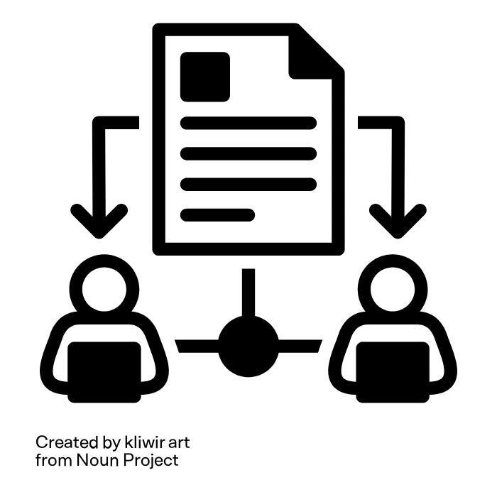

# Fair Share

*Logo: "file sharing" by kliwir art, from the Noun Project (CC BY 3.0).*

**Mission:** Making group work fair and visible.

## Team

* **Project Manager:** Yehia (GitHub: [YehiaElsakka](https://github.com/YehiaElsakka)). Keeps meetings running, tracks who is doing what and when, and looks after how we work together.
* **Designer:** Alex. Leads our understanding of the problem, the design spec, usability testing, and the look of the app.
* **Developers:** Mahan, Johnny, and Nashwan. Check that the design can actually be built, build it, and deal with bugs and deployment.

Our roles overlap a lot, and everyone pitches in across roles when needed.

**Values:** We care about trust and psychological safety (Edmondson, 1999). In practice that means giving feedback early and kindly, assuming good intent, and letting people do their work without hovering over them.

**Working agreements:**

* **Meetings:** We meet once a week on Tuesdays at 6:00 pm for about 45 minutes, plus a quick 15 minute check in on Fridays. We meet on Discord, or in person when we are all on campus.
* **Communication:** Our main channel is a group chat on Discord. We keep project decisions in the chat or in GitHub issues so nothing gets lost.
* **Response time:** We reply within 24 hours, and faster when a deadline is less than two days away. If someone will be unavailable, they let the team know ahead of time.
* **Decisions:** We try to reach agreement by talking it through. If we still disagree, everyone explains their reasoning and we vote. A tie goes to the person whose role covers the decision (the designer for design questions, the developers for technical ones).
* **Accountability:** Every task has one owner and a due date. If someone is falling behind, they say so early so the rest of us can help, and nobody gets blamed.

## Problem

Almost every university student has been in a group project where a few people ended up doing most of the work. This does real damage. The people carrying the team get worn out and start to resent their teammates. The people doing less learn less of the material. Grades end up saying little about who actually learned what, and trust between teammates breaks down, which defeats the whole point of working as a team.

Researchers have understood part of this for decades. People tend to put in less effort in a group than they would on their own, especially when nobody can see or measure what each person contributed (Latané, Williams & Harkins, 1979). Student teams make it worse in a few ways. Ownership is vague ("someone will do the slides"). Promises get made out loud in a meeting and then forgotten. And asking a classmate "did you do your part?" feels awkward, so people put it off. Because nobody can see who promised what, teams usually find out about a missed commitment only hours before the deadline, when it is too late to fix calmly.

We also asked three classmates about their worst group project experiences, and their stories follow the same pattern. One described a teammate who kept saying they were working on their part until a few days before the deadline, when the team opened the shared document and found nothing there, so everyone else split up the missing work. Another described a teammate who always had an excuse and skipped several check ins without showing any progress, which ended with the team handing out their tasks to other people. A third described a presentation where one person's section was completely different from what the team had agreed on, and nobody noticed until they put everything together the day before presenting. In all three cases the problem showed up late, after the point where it would have been easy to fix, and each person came away thinking that expectations and progress should have been out in the open sooner.

Existing practices only help a little. Peer evaluations come after the project is over, when the damage is already done. Group chats bury commitments under everything else people are talking about. Project management tools built for professionals need setup and upkeep that students rarely keep going, and they are mostly designed for a boss handing out tasks, not for teammates making promises to each other. So student teams have no easy, friendly way to see early and often who has agreed to do what, and whether it is getting done.

*How can student teams make each member's commitments visible early enough that missed work can be noticed and fixed, without making teammates feel policed?*

## Links

* Design specification: [SPEC.md](SPEC.md)

## References

* Edmondson, A. (1999). Psychological safety and learning behavior in work teams. *Administrative Science Quarterly, 44*(2), pp. 350 to 383.
* Latané, B., Williams, K., & Harkins, S. (1979). Many hands make light the work: The causes and consequences of social loafing. *Journal of Personality and Social Psychology, 37*(6), pp. 822 to 832.
